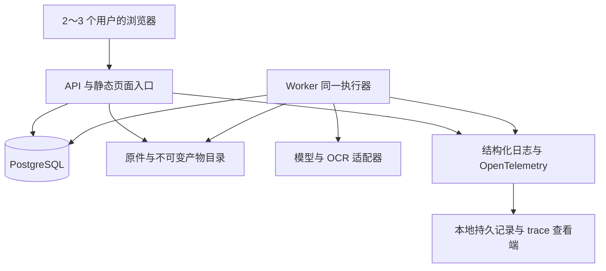

# 架构与数据

## 一个模块化应用

采用 Python/FastAPI API、同代码包的独立 Worker、Vue 前端、PostgreSQL 和本地受控文件存储。单机 Docker Compose 部署，前端静态文件由同站点入口提供。Provider 和 OCR 各有一个窄适配接口；实施时锁定测试过的依赖与镜像版本，不继承旧项目全部依赖。

API 只做鉴权、上传、命令和状态读取。长时间解析、模型调用和渲染由 Worker 执行。[FastAPI 官方文档](https://fastapi.tiangolo.com/tutorial/background-tasks/)将重型后台计算与简单响应后任务区分；本项目选择独立 Worker 以支持进程重启后的任务恢复，不依赖请求进程寿命。

首版无需 Redis、RabbitMQ、Celery 集群、独立向量数据库、LangGraph、Harness 或通用 Agent 平台。少量资料的结构化筛选、关键词和向量召回可放在 PostgreSQL；是否启用 pgvector 与所选 embedding 适配器由首批检索样本决定，不能因为未配 embedding 就静默返回空证据。

## 最小数据职责

以下是逻辑职责，不以“表越少越好”为目标。需要约束、鉴权和查询的字段关系化；节点大正文保存在受控 JSON/文件产物中。

| 对象 | 保存什么 | 不承担什么 |
|---|---|---|
| User | 命名账号、超管/成员（superadmin/member）、登录状态 | 多租户和复杂审批 |
| CompanyProfile / MaterialVersion | 单一固定公司档案、公共资料及其来源/有效期/版本/可用状态 | 公司主体选择/比对/核验、自动升级事实为 verified |
| Project / GenerationRun | Project.owner_user_id、项目身份、冻结输入和执行版本、父 run、重跑起点 | 团队共享标书、另一套独立执行状态机 |
| Job / JobAttempt | 唯一执行状态、游标、幂等、租约、token、取消、尝试结果 | 正文和完整 prompt |
| NodeAttempt | 全节点通用的起止、输入输出 hash、重试、复用来源、trace 引用 | 每个节点一套业务审批表 |
| Artifact | 原件、阶段 JSON、DOCX、清单、诊断产物的类型/hash/存储引用 | 可变在线编辑会话 |
| AuditEvent | 谁修改资料、启动/取消/重跑、读取敏感诊断等业务动作 | 普通运行日志或恢复事实源 |

节点产物里的 Requirements、BidPlan、DraftSections 都有版本化 schema。资料检索索引可以重建，不能成为原件或公司事实的唯一副本。

项目创建时由服务端用登录用户设置 `owner_user_id`，后续 run/job/产物通过项目继承归属，重跑或子 run 不改变所有者。成员的所有项目读取与操作均限定本人；超管可读取所有项目，跨用户修改、取消、重跑不列入首版功能。超管对本人项目仍有正常操作权。

权限使用简单的账号角色与项目归属判断，不建立多公司/多租户模型。公司公共资料库可供各成员的任务使用；项目招标文件、补充资料、结果和诊断按项目隔离。即使文件 hash 相同或底层存储去重，也不能据此绕过归属授权。

## 队列与并发

PostgreSQL job 表采用短事务原子领取、租约和递增 fencing token。`FOR UPDATE SKIP LOCKED` 适合多消费者队列领取，但不用于需要完整一致视图的业务查询。[PostgreSQL SELECT 文档](https://www.postgresql.org/docs/18/sql-select.html)

初始待测配置：最多 3 个活跃生成 run；共享模型请求 2 槽、OCR 1 槽、渲染 1 槽；同 run 章节先串行。限制在全 Worker 范围有效，不能每个 run 各开 2 槽变成 6 个外部调用。暂停单步任务释放租约与执行槽。CPU 密集工作在有数量/内存限制的子进程运行。

首版只运行一个 Worker 服务实例，由同一调度器管理这三个 run 与共享额度；CPU 子进程只执行被分配的工作，不自行领取 job。日后增加 Worker 实例时先实现跨实例配额，不能把各自的进程内 semaphore 当成全局限流。数据库租约和 fencing 仍保留，用于崩溃恢复与重启交错。

三个账号能提交排队不等于三个任务实际并行。验收须测量三个 run 的实际推进、排队原因、资源峰值、外部限流和总完成时间；上述槽位只是起点，不是容量已经通过的结论。界面显示等待资源的原因；较长任务不能无限占用所有调用机会。

## 一个执行状态源

Job 状态：`queued / running / retry_wait / paused_debug / succeeded / failed / cancelled`。`cancel_requested_at` 是取消请求的权威字段；审计事件仅记录动作，不再作为第二个取消状态源。

GenerationRun 的“生成完成，需线下补充”由 succeeded + Issues 投影，不与 Job 状态互相修正。取消、继续、重跑命令都带幂等键和期望 revision，防止重复点击或两人同时操作。

## 不可变版本与原子完成

每次生成一个 run，重新制作或回退重跑创建子 run。每个结果包固定绑定 run，项目页按请求顺序列出历史版本。旧 run 晚完成不能切换用户当前选择或覆盖新 run 文件；首版不需要 current pointer 或在线 revision 树。

渲染、文件 I/O 和外部请求在最终事务外。文件先完整写入临时区、校验后原子发布到受控存储，再用一个短事务完成：锁 job → 检查 token/取消/状态 → 登记结果清单和文件引用 → 写审计 → 完成 job/attempt。所有取消写入也锁同一 job 行。发布先提交则取消返回已完成；取消先提交则禁止发布。[PostgreSQL 行锁](https://www.postgresql.org/docs/18/explicit-locking.html)持续到事务结束，因此不能把模型调用放在持锁区间。

每个节点 checkpoint 也遵守 token/取消校验和“产物引用 + 游标”原子提交。旧 Worker 迟到不能提交新节点或最终结果。同 run 的有效结果使用唯一约束；失败尝试文件不会成为可下载正式结果。

文件已写而事务失败可留下未引用产物；提交结果不明时先按 job/run/幂等键对账，不能立即删除。孤儿回收只处理确认无引用且超过保留窗口的对象，先报告再按限定目录处理；共享资料及被子 run 复用的产物不得回收。

## 部署、备份与边界

新数据库、文件目录、容器/卷名称与旧项目独立；正式库 ai_bid 完全不作开发或测试库。旧历史资料若后续需要导入，走显式原件导入与新版本登记，不复制旧库或接旧表。

少量用户仍需登录和项目归属授权。列表、搜索、状态/SSE、下载及命令接口都校验项目所有者；超管可读取全量项目及敏感诊断，完整诊断不向普通成员开放。项目/run/文件三者必须对应；成员访问他人对象或错误绑定时，统一返回不泄露对象存在的响应。外部 Provider 的密钥只在服务端配置，网页、日志、trace 和诊断包不能包含。

备份覆盖 PostgreSQL、招标和公司原件、正式结果、复用所必需的节点产物与配置版本。首版可在短维护窗口暂停新写入、等待提交完成后建立数据库与文件一致备份；索引、OCR 派生缓存可重建。必须恢复到全新库和目录，核验 hash、下载和任务状态。备份位置与保留策略在部署时明确，不能把同盘临时拷贝当恢复验证。

日志与 trace 的持久化、保留和故障处理另见[日志与调试恢复](05-observability-and-debugging.md)。trace 存储不作为业务或恢复事实源。
